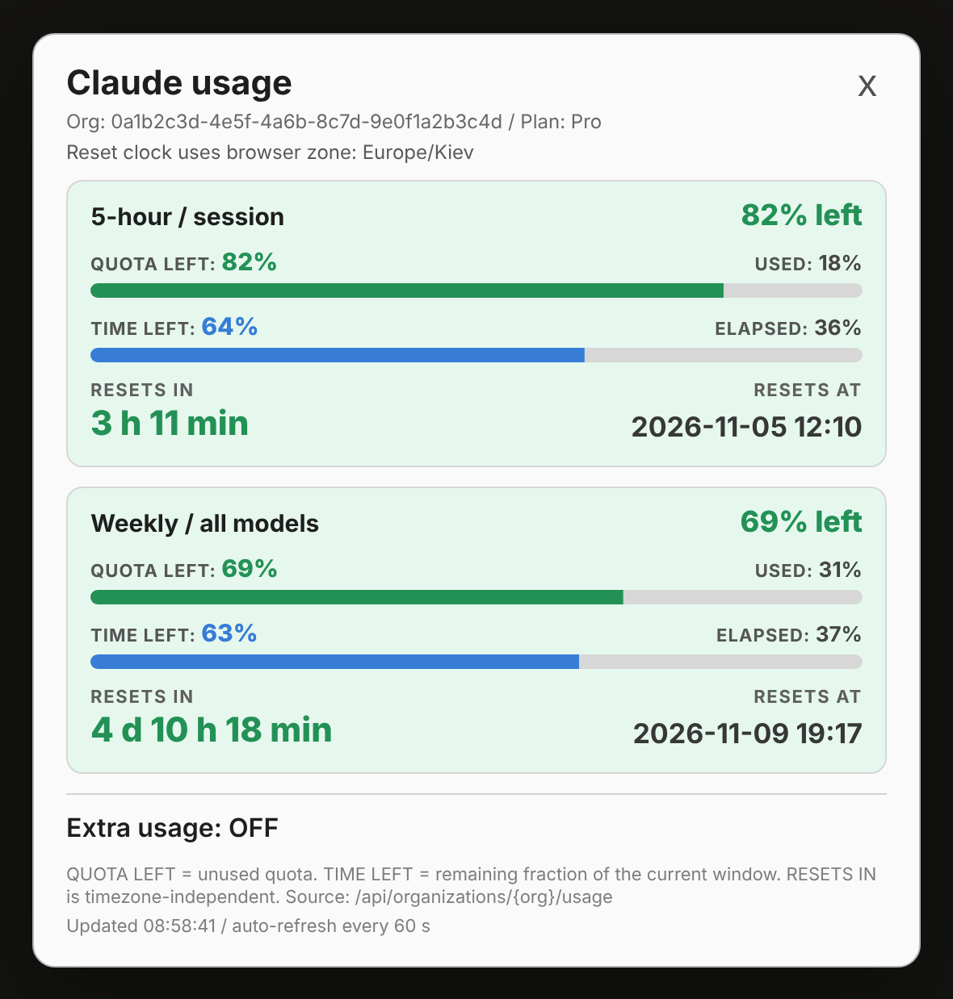
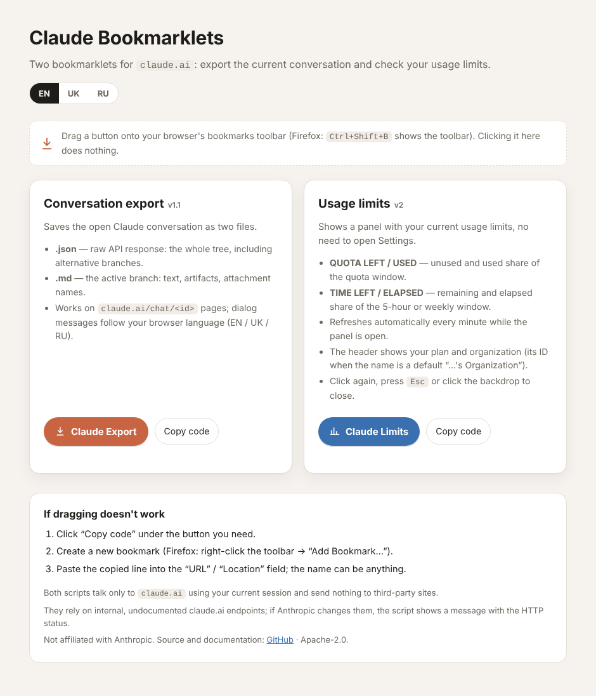

# Claude Export & Limits

**English** · [Українська](README.uk.md)

Two small browser bookmarklets for [claude.ai](https://claude.ai/), made for Firefox / LibreWolf (any browser that allows `javascript:` bookmarks should work):

| Bookmarklet | What it does |
|---|---|
| **Claude Export** | Saves the open conversation as a `.json` file (raw API response, all branches) and a `.md` file (the active branch as readable Markdown). |
| **Claude Limits** | Shows a panel with your current usage limits (5-hour session, weekly, per-model) and reset times, without opening *Settings → Usage*. Refreshes itself every minute. |

No extension, no server, no account: each bookmarklet is a single line of JavaScript stored in your bookmarks and run on demand.

<p align="center"></p>

## Quick start

1. Open the installer page (EN / UK / RU, auto-detected):
   **<https://remont.uktn.tk/articles/files/claude-bookmarklets-export-and-limits-v2.html>**
   It is the same file as [`docs/index.html`](docs/index.html) in this repository, so you can also download it and open it locally.
2. Drag **Claude Export** and **Claude Limits** onto your bookmarks toolbar (Firefox: `Ctrl+Shift+B` shows the toolbar).
   If dragging does not work, press *Copy code*, create a bookmark manually and paste the line into its *URL* field.
3. Open [claude.ai](https://claude.ai/) and click the bookmark.

> GitHub shows HTML files only as source code and does not render them, which is why the installer page is linked from an external site. The files in [`dist/`](dist/) contain the same bookmarklets as plain text if you prefer to paste them yourself.

<p align="center"></p>

## Claude Export

1. Open a conversation: `https://claude.ai/chat/<id>`.
2. Click **Claude Export** and confirm the dialog.
3. Two files are downloaded: `<title>_<first 8 chars of id>.json` and `.md`.

**JSON** is the raw API response (`?tree=True`): every message and every alternative branch.
**Markdown** contains the active branch only (from `current_leaf_message_uuid` up through `parent_message_uuid`): visible text, artifacts as code blocks and attachment names. Thinking blocks, tool calls and tool results are skipped; their count is printed to the browser console. To include the thinking blocks, set `INCLUDE_THINKING = true` in `src/export.src.js` and rebuild (see below).

The organization is taken from the `lastActiveOrg` cookie; if the conversation is not found there, every organization from `/api/organizations` is tried, so several accounts and Team/Enterprise workspaces work.

Dialog and error messages are shown in English, Ukrainian or Russian depending on the browser language (`LANG_OVERRIDE` in the source forces one).

## Claude Limits

Click **Claude Limits** on any claude.ai page; click it again, press `Esc` or click the backdrop to close.

For every rate-limit window (5-hour session, weekly all models, weekly per model, …) the panel shows:

- **QUOTA LEFT / USED**: unused and used share of the quota. The card turns orange at 30% left or less and red at 10% or less; `LIMIT REACHED` appears at 100% used.
- **TIME LEFT / ELAPSED**: remaining and elapsed share of the 5-hour or weekly window.
- **RESETS IN / RESETS AT**: countdown and the reset time in your browser's time zone.
- **Extra usage** status, when the account has it.

The header shows the plan (Pro, Max 5x/20x, Team, Enterprise, Free) and the organization: its name, or its ID when the name is the default "…'s Organization" (the same ID as in *Settings*). While the panel is open, the data is re-requested every 60 seconds; if a refresh fails, the last data stays on screen with an error note. New windows that Anthropic may add later appear automatically. The panel interface is English only.

## Privacy and security

- Both bookmarklets call only `claude.ai` (same-origin `/api/...` requests with your current session cookies). Nothing is sent to any third-party site, no token is stored, nothing is logged remotely.
- A bookmarklet runs with the full privileges of the claude.ai page. Install bookmarklets only from sources you trust: read [`src/`](src/) (the readable code) or rebuild `dist/` yourself with `npm run build`.
- The exported JSON/Markdown files contain your conversation; store them accordingly.

## Limitations

- These are **unofficial** tools. They rely on internal, undocumented claude.ai endpoints (`/api/organizations/{org}/chat_conversations/{id}`, `/api/organizations/{org}/usage`). If Anthropic changes them, the bookmarklet shows an error with the HTTP status, or, for Limits, the raw response.
- Plan detection is heuristic (it looks at the organization's `capabilities`, `rate_limit_tier` and `billing_type`). If nothing is recognized, the raw value is shown. The organization object is printed to the browser console ("Claude Limits: organization object"); if you open an issue about a wrong plan, please paste it **with your IDs and e-mail removed**.
- Automated tests run against a mocked claude.ai and a headless Chromium; the live service is not part of the tests.
- Not affiliated with or endorsed by Anthropic. "Claude" is a trademark of Anthropic.

## Repository layout

```
src/export.src.js          readable source of Claude Export
src/limits.src.js          readable source of Claude Limits
src/page.template.html     installer page template
src/i18n.json              page texts (en / uk / ru)
dist/*.bookmarklet.txt     built one-line bookmarklets (generated)
docs/index.html            built installer page (generated)
docs/img/                  screenshots
tools/build.js             build script
test/run.js                tests on a mocked claude.ai
```

## Build and test

Requires Node.js 18 or newer, no dependencies.

```sh
npm run build   # src/ -> dist/ and docs/index.html
npm run check   # fails if dist/ or docs/ are out of date
npm test        # smoke tests: sources and built bookmarklets
```

Rules for the source files: end every statement with a semicolon (line breaks are stripped by the build) and do not write the percent sign (it breaks `javascript:` URLs; use `String.fromCharCode(37)`). Non-ASCII characters and `#` inside strings are escaped automatically. To translate the page, edit `src/i18n.json`.

## Changelog

See [CHANGELOG.md](CHANGELOG.md).

## License

[Apache License 2.0](LICENSE)
