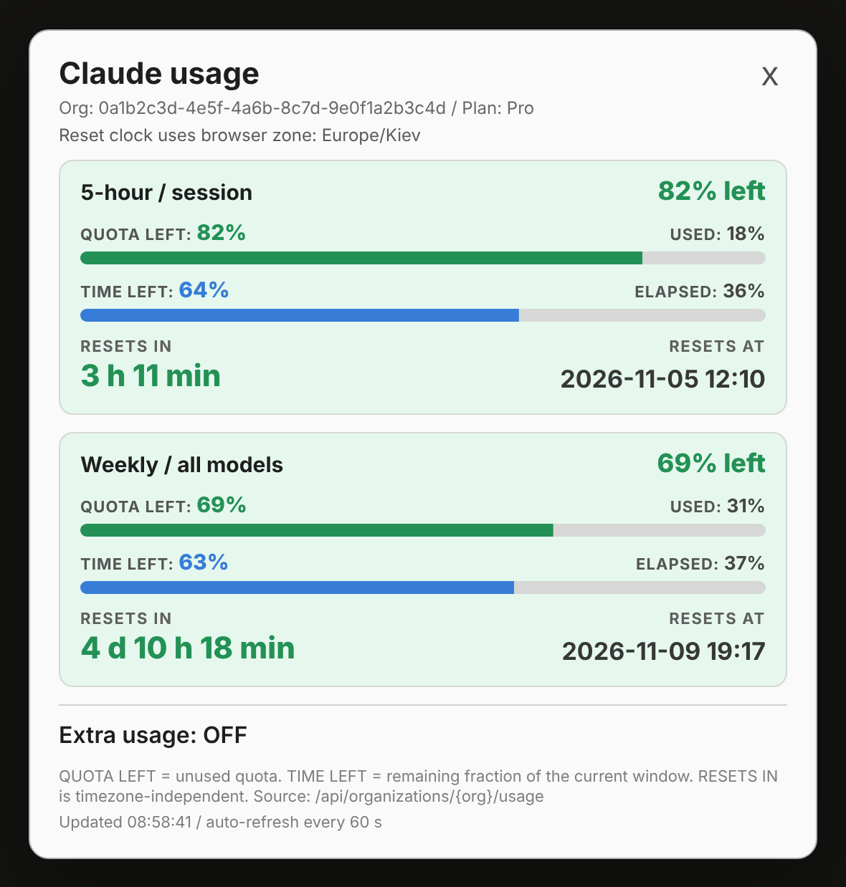
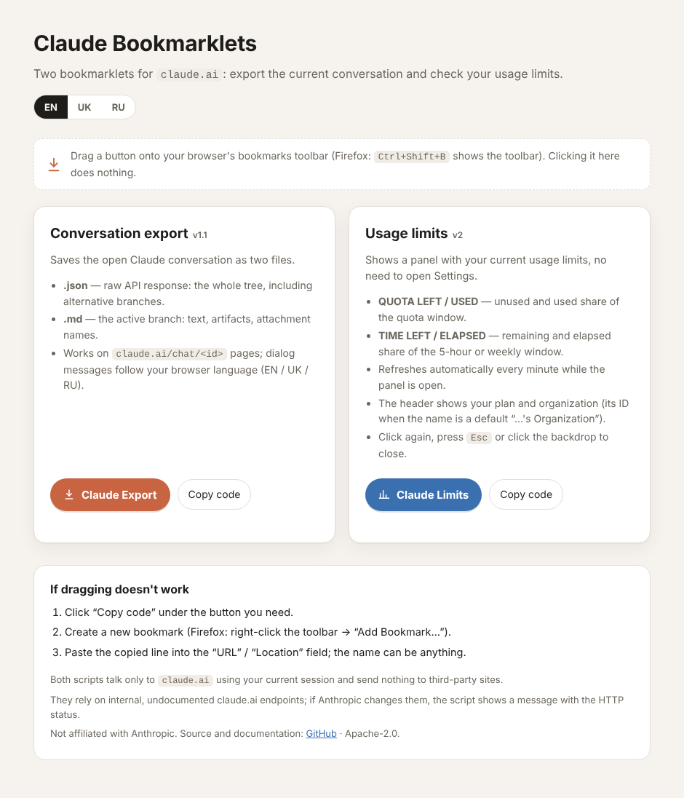

# Claude Export & Limits

[English](README.md) · **Українська**

Дві невеликі браузерні закладки (bookmarklets) для [claude.ai](https://claude.ai/), створені для Firefox / LibreWolf (мають працювати в будь-якому браузері, що дозволяє закладки `javascript:`):

| Закладка | Що робить |
|---|---|
| **Claude Export** | Зберігає відкриту розмову у файл `.json` (сира відповідь API, усі гілки) та файл `.md` (активна гілка у вигляді читабельного Markdown). |
| **Claude Limits** | Показує панель із поточними лімітами використання (5-годинна сесія, тижневі, по моделях) і часом скидання без переходу в *Settings → Usage*. Сама оновлюється щохвилини. |

Без розширень, сервера чи облікового запису: кожна закладка — один рядок JavaScript у ваших закладках, який виконується за кліком.

<p align="center"></p>

## Швидкий старт

1. Відкрийте сторінку-установник (EN / UK / RU, мова визначається автоматично):
   **<https://remont.uktn.tk/articles/files/claude-bookmarklets-export-and-limits-v2.html>**
   Це той самий файл, що й [`docs/index.html`](docs/index.html) у цьому репозиторії, тож його можна також завантажити й відкрити локально.
2. Перетягніть **Claude Export** і **Claude Limits** на панель закладок (Firefox: `Ctrl+Shift+B` показує панель).
   Якщо перетягування не спрацювало, натисніть *Копіювати код*, створіть закладку вручну й вставте рядок у поле *URL*.
3. Відкрийте [claude.ai](https://claude.ai/) і клацніть закладку.

> GitHub показує HTML-файли лише як вихідний код і не відображає їх як сторінки, тому сторінку-установник подано за посиланням на стороннім сайті. Файли в [`dist/`](dist/) містять ті самі закладки звичайним текстом, якщо ви хочете вставити їх самостійно.

<p align="center"></p>

## Claude Export

1. Відкрийте розмову: `https://claude.ai/chat/<id>`.
2. Клацніть **Claude Export** і підтвердьте діалог.
3. Завантажаться два файли: `<назва>_<перші 8 символів id>.json` та `.md`.

**JSON** — сира відповідь API (`?tree=True`): усі повідомлення й усі альтернативні гілки.
**Markdown** містить лише активну гілку (від `current_leaf_message_uuid` угору за `parent_message_uuid`): видимий текст, артефакти у вигляді блоків коду та назви вкладень. Блоки thinking, виклики інструментів та їхні результати пропускаються; їхню кількість виведено в консоль браузера. Щоб додати блоки thinking, змініть у `src/export.src.js` значення `INCLUDE_THINKING = true` і перезберіть проєкт (див. нижче).

Організація береться з cookie `lastActiveOrg`; якщо розмову там не знайдено, перебираються всі організації з `/api/organizations`, тож кілька акаунтів і робочі простори Team/Enterprise підтримуються.

Повідомлення діалогів і помилок показуються англійською, українською або російською залежно від мови браузера (`LANG_OVERRIDE` у коді примусово задає одну з них).

## Claude Limits

Клацніть **Claude Limits** на будь-якій сторінці claude.ai; повторний клік, `Esc` або клік по фону закривають панель.

Для кожного вікна лімітів (5-годинна сесія, тижневе для всіх моделей, тижневе по моделях, …) панель показує:

- **QUOTA LEFT / USED** — невикористана та використана частка квоти. Картка стає помаранчевою при залишку 30% і менше та червоною при 10% і менше; при 100% використання з'являється `LIMIT REACHED`.
- **TIME LEFT / ELAPSED** — залишок і частка минулого часу 5-годинного або тижневого інтервалу.
- **RESETS IN / RESETS AT** — зворотний відлік і час скидання в часовому поясі браузера.
- Стан **Extra usage**, якщо він є в акаунті.

У заголовку вказано план (Pro, Max 5x/20x, Team, Enterprise, Free) і організацію: її назву або її код, якщо назва типова «…'s Organization» (той самий код, що в *Settings*). Поки панель відкрита, дані повторно запитуються кожні 60 секунд; якщо оновлення не вдалося, на екрані лишаються останні дані з приміткою про помилку. Нові вікна лімітів, які Anthropic може додати згодом, з'являються автоматично. Інтерфейс панелі лише англійською.

## Приватність і безпека

- Обидві закладки звертаються лише до `claude.ai` (запити `/api/...` на тому самому домені з вашими поточними cookie сесії). Нічого не надсилається на сторонні сайти, токени не зберігаються, віддалено нічого не логується.
- Закладка виконується з повними правами сторінки claude.ai. Встановлюйте закладки лише з джерел, яким довіряєте: прочитайте [`src/`](src/) (читабельний код) або самостійно перезберіть `dist/` командою `npm run build`.
- Експортовані JSON/Markdown містять вашу розмову; зберігайте їх відповідно.

## Обмеження

- Це **неофіційні** інструменти. Вони спираються на внутрішні недокументовані ендпоінти claude.ai (`/api/organizations/{org}/chat_conversations/{id}`, `/api/organizations/{org}/usage`). Якщо Anthropic їх змінить, закладка покаже помилку з HTTP-кодом, а Limits — сиру відповідь.
- Визначення плану евристичне (враховуються `capabilities`, `rate_limit_tier` і `billing_type` організації). Якщо нічого не розпізнано, показується сире значення. Об'єкт організації виводиться в консоль браузера («Claude Limits: organization object»); якщо створюєте issue про неправильний план, вставте його **без ваших ідентифікаторів та e-mail**.
- Автоматичні тести працюють на імітації claude.ai та headless Chromium; жива служба в тестах не бере участі.
- Проєкт не пов'язаний з Anthropic і не схвалений нею. «Claude» — торговельна марка Anthropic.

## Структура репозиторію

```
src/export.src.js          читабельний код Claude Export
src/limits.src.js          читабельний код Claude Limits
src/page.template.html     шаблон сторінки-установника
src/i18n.json              тексти сторінки (en / uk / ru)
dist/*.bookmarklet.txt     зібрані закладки одним рядком (генерується)
docs/index.html            зібрана сторінка-установник (генерується)
docs/img/                  скриншоти
tools/build.js             скрипт збирання
test/run.js                тести на імітації claude.ai
```

## Збирання і тести

Потрібен Node.js 18 або новіший, залежностей немає.

```sh
npm run build   # src/ -> dist/ і docs/index.html
npm run check   # помилка, якщо dist/ або docs/ застаріли
npm test        # smoke-тести: вихідний код і зібрані закладки
```

Правила для вихідних файлів: завершуйте кожен оператор крапкою з комою (переноси рядків під час збирання видаляються) і не пишіть символ відсотка (він ламає `javascript:`-URL; використовуйте `String.fromCharCode(37)`). Не-ASCII символи та `#` у рядках екрануються автоматично. Щоб перекласти сторінку, відредагуйте `src/i18n.json`.

## Журнал змін

Див. [CHANGELOG.md](CHANGELOG.md).

## Ліцензія

[Apache License 2.0](LICENSE)
